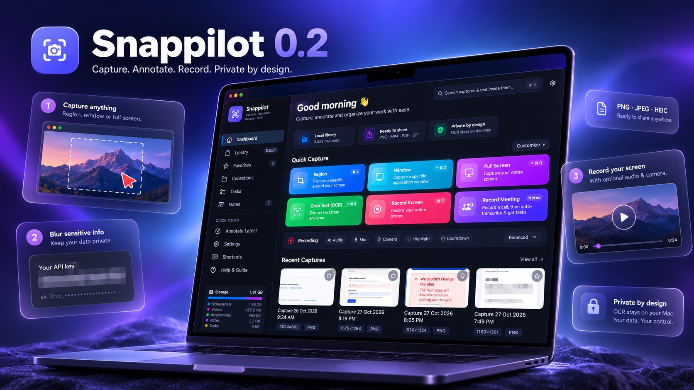
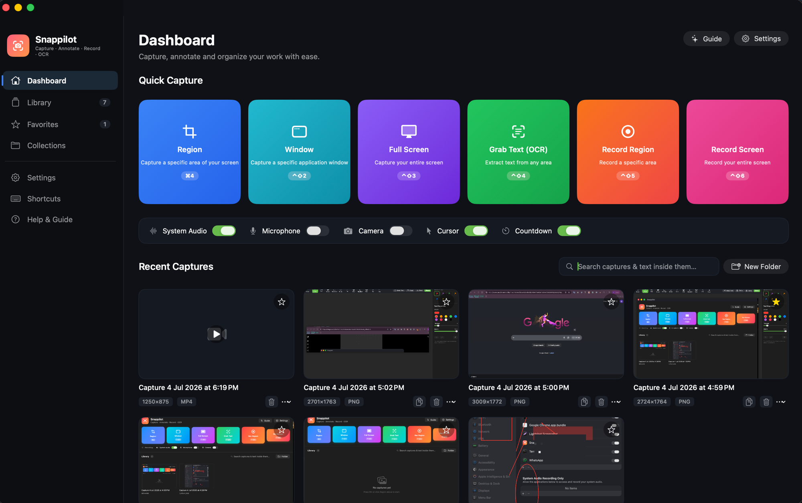
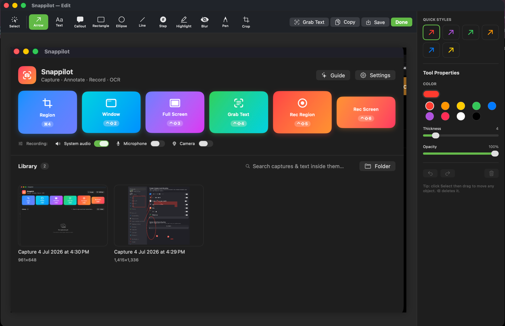

<p align="center">
  
</p>

<h1 align="center">Snappilot</h1>

<p align="center">
  <b>The free, open-source screen capture studio for macOS.</b><br>
  Capture, annotate, record and extract text — natively, and entirely on your Mac.
</p>

<p align="center">
  <a href="https://github.com/shipiit/snappilot/releases/latest"></a>
  
  
  
  
</p>

<p align="center">
  <a href="https://github.com/shipiit/snappilot/releases/latest/download/Snappilot.dmg"><b>Download for Mac</b></a>
  &nbsp;·&nbsp;
  <a href="https://snappilot.vercel.app">Website</a>
  &nbsp;·&nbsp;
  <a href="https://snappilot.vercel.app/docs">Documentation</a>
  &nbsp;·&nbsp;
  <a href="https://github.com/shipiit/snappilot/releases">Release notes</a>
</p>

<!-- Demo GIF: save a 5–8 s recording as docs/assets/demo.gif, then uncomment the next three lines.
<p align="center">
  
</p>
-->

---

## Why Snappilot

Snappilot does what Snagit and CleanShot do — region capture, a full annotation editor,
screen recording and OCR — without a subscription, an account, or anything leaving your Mac.

|  |  |
|---|---|
| **Free and open source** | MIT licensed. No trial, no paywall, no subscription. |
| **Private by design** | No telemetry, no cloud, no sign-in. Text recognition and transcription run on-device with Apple's frameworks. |
| **Native and light** | Swift, SwiftUI and ScreenCaptureKit. No Electron; small, fast and Retina-sharp. |
| **Searchable library** | Every capture is saved locally and indexed by the text inside it. |

## What's new in 0.2

- **Re-open and keep editing.** Double-click any capture to open it in the editor — arrows,
  text and shapes stay editable. *Save as New Capture* keeps the original.
- **Open your own files.** Annotate PNG, JPEG, HEIC, TIFF and MP4 files via **File › Open**,
  Finder's **Open With**, or by dropping them on the Dock icon.
- **Choose a save format.** PNG, JPEG or HEIC, with a quality setting.
- **Stronger redaction.** Pixelate, Blur or Solid — shown live while you edit.
- **A redesigned dashboard and menu bar**, new Screenshots and Recording settings, standard
  editing shortcuts (⌘Z, ⌘C/⌘V, ⌘D, arrow-key nudge), alignment guides and saved styles.
- **Lighter and steadier:** much lower memory use, recordings with a single mixed audio track,
  and a fix for a crash when starting a capture.

See the [full release notes](https://github.com/shipiit/snappilot/releases/tag/v0.2.0).

## Screenshots

<table>
  <tr>
    <td width="50%" valign="top">
      <br>
      <b>Dashboard</b> — quick capture tools, recording options, and a searchable library.
    </td>
    <td width="50%" valign="top">
      <br>
      <b>Editor</b> — arrows, callouts, steps, highlight, blur, stamps, layers and quick styles.
    </td>
  </tr>
</table>

## Features

### Capture
- **Region, window and full screen**, with a magnifier loupe and live pixel dimensions.
- **Scrolling capture** that stitches a long page into one image.
- **Grab Text** — select any area and copy its text (Apple Vision OCR).
- **Webcam photo**, **step recorder** (one screenshot per click), and **presets**.
- Optional delay, mouse pointer and window shadow; choose to open the editor, copy to the
  clipboard, or just save after each capture.
- Global shortcuts for every capture, all customizable.

### Annotate
- Arrows, lines, shapes, text, callouts, freehand pen, highlighter, emoji stamps and
  auto-numbered **step badges** (1·2·3, A·B·C).
- **Blur / redact** as pixelate, blur or solid; **auto-redact** detects emails and card numbers.
- Select any annotation to restyle it, resize it with handles, or copy and paste it.
- **Image layers** — drop in other captures or files, stack them, and click to bring one forward.
- Alignment guides, saved styles with *apply to all*, crop, rotate, rounded corners, and an
  expandable canvas for combining screenshots.
- Smart Move, editable recognized text, spotlight, magnify, background removal.
- Edits are saved as an editable project next to each capture, so you can come back later.

### Record
- Record a **region or the whole screen** to compact HEVC MP4, at three quality levels.
- System audio, microphone (with noise cancellation) and a webcam bubble with background blur.
- Countdown, pause / resume, cursor highlight and click ripples, drawing on screen while
  recording, and screenshots mid-recording.
- Built-in player with trim, frame export, timed annotations, clip combining and **GIF export**.

### Meeting Mode
- Record a call and get an on-device **transcript**, split into *You* and *Participants*
  (speaker names come from Google Meet captions when they're on).
- Automatic **summary, action items and key points**, saved as Markdown and importable into
  the task board.

### Organize
- A local **library** that's searchable by the text inside your captures, with favorites,
  tags, collections, PDF and batch export, and pin-to-screen.
- A **task board** (To do / In progress / Review / Done) with subtasks, comments,
  attachments and due-date reminders.
- A **Markdown notes** workspace with live preview and images.

## Keyboard shortcuts

| Shortcut | Action | Shortcut | Action |
|---|---|---|---|
| `⌃⇧1` | Capture region | `⌃⇧5` | Record region |
| `⌃⇧2` | Capture window | `⌃⇧6` | Record screen |
| `⌃⇧3` | Capture full screen | `⌃⇧7` | Scrolling capture |
| `⌃⇧4` | Grab text (OCR) | `⌃⇧8` | Record meeting |
| `⌘O` | Open a file to annotate | `⌃⇧.` | Stop recording |

Global shortcuts can be changed in **Settings › Shortcuts**. In the editor: letter keys pick
tools (`A` arrow, `T` text, `R` rectangle, `S` step, `B` blur, `V` select), `⌘Z` / `⇧⌘Z`
undo and redo, and `⌥⌘S` saves as a new capture.

## Install

1. [Download **Snappilot.dmg**](https://github.com/shipiit/snappilot/releases/latest/download/Snappilot.dmg)
   and drag Snappilot into **Applications**.
2. The app isn't notarized yet, so the first time, **right-click it › Open**
   (or run `xattr -cr /Applications/Snappilot.app`).
3. When asked, allow **Screen Recording** — plus Microphone and Camera if you record with them —
   in **System Settings › Privacy & Security**.

Requires macOS 14 Sonoma or later.

## Privacy

Snappilot has no servers. Captures, recordings, transcripts and notes are stored in
`~/Pictures/Snappilot` and never uploaded. There is no telemetry, analytics or account.

## Build from source

Requires Xcode 16+ and [XcodeGen](https://github.com/yonaskolb/XcodeGen) (`brew install xcodegen`).

```bash
git clone https://github.com/shipiit/snappilot.git && cd snappilot
xcodegen generate          # creates Snappilot.xcodeproj
open Snappilot.xcodeproj   # then Run (⌘R)

swift run snapverify       # logic tests for SnapCore
```

### Project layout

- **`Sources/SnapCore`** — a UI-free Swift package with the testable logic: capture geometry,
  OCR, image operations, redaction, the annotation model, project files and the library index.
- **`App`** — the SwiftUI and AppKit app: capture overlay, ScreenCaptureKit, editor,
  recorder, player, dashboard, menu bar and settings.

## Roadmap

- More customizable shortcuts and appearance settings
- Editor: multi-select, layers panel, grouping, callout tails and text styling
- Smart Redact with reviewable categories (phone numbers, addresses, IPs and more)
- Step-by-step guides that export to PDF and Markdown
- Video timeline editing and captions from transcripts

Ideas and requests are welcome in [Issues](https://github.com/shipiit/snappilot/issues).

## Contributing

Contributions are welcome — please read [CONTRIBUTING.md](CONTRIBUTING.md) first.
[Report a bug](https://github.com/shipiit/snappilot/issues/new/choose) or
[request a feature](https://github.com/shipiit/snappilot/issues/new/choose).
Security issues should be reported privately; see [SECURITY.md](SECURITY.md).

## More from Shipiit

- [**Mac Sweep**](https://github.com/shipiit/mac-sweep) — clean, monitor and understand your Mac.
- [**KeyVault**](https://github.com/shipiit/keyvault) — a local-only, zero-knowledge password manager for Chrome.

## License

MIT
